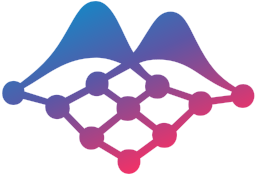

<p align="center">
  <picture>
    <source media="(prefers-color-scheme: dark)" srcset="assets/mark.svg">
    
  </picture>
</p>

<p align="center">
  <a href="https://synthstats.org"></a>
  <a href="LICENSE"></a>
  <a href="pyproject.toml">=3.12,<3.14"></a>
</p>

# SynthStats

SynthStats trains language-model agents to write probabilistic programs.

## Install

```bash
git clone https://github.com/SynthStats/synthstats.git
cd synthstats
uv sync
```

## Example: show the dugongs training configuration

```bash
uv run synthstats-train env=dugongs --cfg job
```

## Contents

| Command or file | Purpose |
| --- | --- |
| `synthstats-train` | Train an agent |
| `src/synthstats/configs/train.yaml` | Default training configuration |
| `src/synthstats/train/gfn_core.py` | Shared trainer logic |

[Project](https://synthstats.org).

SynthStats is distributed under the [MIT licence](LICENSE).
